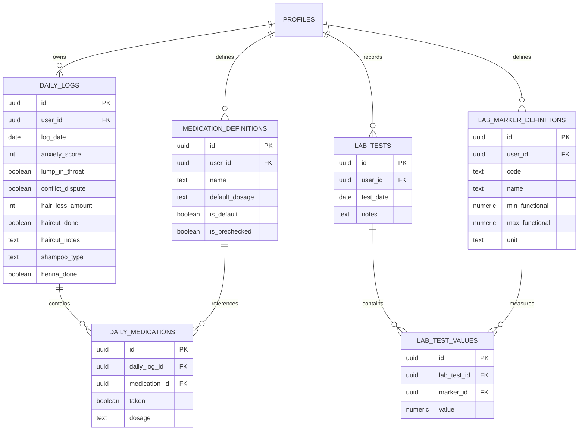

# Plan de Développement : Application Suivi Santé & Cheveux (Hair & Health Tracker)

## 1. Vue d'ensemble du Projet

Application mobile développée en **React Native avec Expo (TypeScript)**, connectée à **Supabase** (PostgreSQL, Auth, RLS) pour la sauvegarde dans le cloud et la synchronisation multi-appareils via **Google OAuth**.

L'application permet d'enregistrer et de corréler :
1. **L'état émotionnel & physique** (anxiété /10, boule dans la gorge, disputes de couple).
2. **La santé capillaire** (chute de cheveux en nombre estimé chiffré, coupes + commentaires, lavages + types de shampoings, pose de henné).
3. **Les compléments & médicaments** (fer bisglycinate + vit C, magnésium, B12, forcapil, iode, sélénium, myo-inositol, + ajout libre).
4. **Les bilans sanguins & normes fonctionnelles** (TSH, NFS, T3, T4, TPO, Ferritine, etc., avec définition personnalisée des intervalles fonctionnels optimaux pour les cheveux).
5. **Tableau de bord statistique** (corrélations stress/chute, régularité des prises, historique).
6. **Calendrier visuel** avec pastilles/icônes filtrables selon les catégories.
7. **Export Excel (.xlsx)** paramétrable par période et par types de données.

### Choix validés :
- **Environnement de test** : Expo Go avec flux Supabase WebBrowser (`expo-web-browser` / `expo-auth-session`).
- **Saisie chute de cheveux** : Saisie numérique directe (ex: 40, 80, 150 cheveux).
- **Thème visuel** : Moderne, neutre et minimaliste (ardoise `#1E293B`, bleu nuit `#0F172A`, touches subtiles de contraste).

---

## 2. Architecture Technique & Dépendances Clés

```
┌────────────────────────────────────────────────────────┐
│                   React Native (Expo)                  │
│  ┌──────────────────┐  ┌────────────────────────────┐  │
│  │   Expo Router    │  │       UI Components        │  │
│  │ (Tabs & Modals)  │  │(Lucide Icons / NativeWind) │  │
│  └─────────┬────────┘  └─────────────┬──────────────┘  │
│            │                         │                 │
│  ┌─────────▼─────────────────────────▼──────────────┐  │
│  │           TanStack Query (React Query)           │  │
│  │        + Gestion du cache / Offline First        │  │
│  └─────────────────────┬────────────────────────────┘  │
│                        │                               │
│  ┌─────────────────────▼────────────────────────────┐  │
│  │       Supabase Client & AuthSession (Google)     │  │
│  └──────────────────────────────────────────────────┘  │
└────────────────────────┬───────────────────────────────┘
                         │
        ┌────────────────▼────────────────┐
        │        Supabase Cloud           │
        │  - PostgreSQL + Row Level Sec   │
        │  - Google OAuth Provider        │
        └─────────────────────────────────┘
```

### Dépendances prévues :
- **Framework** : `expo` (SDK 51+), `expo-router`, `typescript`
- **Authentification & Données** : `@supabase/supabase-js`, `expo-auth-session`, `expo-crypto`, `expo-web-browser`
- **État & Cache** : `@tanstack/react-query`, `@react-native-async-storage/async-storage`
- **Composants & Graphismes** :
  - `lucide-react-native` (icônes modernes et légères)
  - `react-native-calendars` ou composant calendrier custom fluide
  - `react-native-gifted-charts` (statistiques et évolutions claires)
- **Export Excel** : `xlsx`, `expo-file-system`, `expo-sharing`
- **Style** : `nativewind` (Tailwind CSS) ou Thème personnalisé soigné (pastels, doux, orienté bien-être)

---

## 3. Modèle de Données Supabase (Schéma SQL)

Chaque table est protégée par **Row Level Security (RLS)** pour garantir que chaque utilisatrice n'accède qu'à ses propres données (`auth.uid() = user_id`).



---

## 4. Découpage Étape par Étape

### Phase 1 : Initialisation & Socle Technique
1. **Création du projet Expo** avec template TypeScript et structure Expo Router.
2. Configuration des variables d'environnement (`.env` avec Supabase URL & Anon Key).
3. Configuration du système de navigation à onglets (Bottom Tabs) :
   - 📊 **Tableau de bord** (Stats & résumés)
   - 📅 **Calendrier** (Vue chronologique avec pastilles et filtres)
   - ➕ **Saisie du jour** (Bouton central rapide pour enregistrer la journée)
   - 💉 **Normes & Bilans** (Gestion des seuils fonctionnels et saisie des prises de sang)
   - ⚙️ **Paramètres & Export** (Export Excel, gestion compte Google)

### Phase 2 : Authentification Supabase & Google OAuth
1. Configuration du client Supabase avec persistance de session (`AsyncStorage`).
2. Mise en place de la connexion Google via `expo-auth-session` / `expo-web-browser`.
3. Écran de bienvenue / connexion et redirection sécurisée avec statut de synchronisation cloud.

### Phase 3 : Module de Saisie Quotidienne (Journal du Jour)
1. Sélecteur de date (par défaut aujourd'hui, possibilité de renseigner un jour passé).
2. **Bloc Santé & Stress** :
   - Curseur / Slider d'anxiété (0 à 10) avec code couleur (vert -> orange -> rouge).
   - Switch / Bouton bascule : "Boule dans la gorge".
   - Switch / Bouton bascule : "Grosse dispute".
3. **Bloc Traitements & Compléments** :
   - Liste pré-remplie et pré-cochée (Fer bisglycinate + Vit C, Magnésium, B12).
   - Sélecteur de dosage (Forcapil 1 ou 2 gélules, Iode, Sélénium, Myo-inositol).
   - Bouton "+ Ajouter un complément personnalisé" (sauvegardé pour les futures saisies).
4. **Bloc Soins Capillaires** :
   - Évaluation de la perte de cheveux (estimation numérique ou échelle : Légère, Modérée, Importante, Massive).
   - Lavage : Sélecteur de shampoing (*Bébé*, *Sans sulfate*, *Avec sulfate*, *Traitant*).
   - Soin au Henné (Case à cocher).
   - Coupe de cheveux (Case à cocher + champ commentaire libre).
5. Enregistrement automatique ou bouton de validation avec feedback visuel.

### Phase 4 : Calendrier Interactif avec Filtres & Icônes
1. Vue calendrier hebdomadaire et mensuelle.
2. Système de pastilles / badges icônes dynamiques sous chaque date :
   - 💇‍♀️ *Ciseaux* pour coupe de cheveux.
   - 🧴 *Flacon* pour lavage / shampoing.
   - 🌿 *Feuille* pour pose de henné.
   - 💊 *Pilule* pour médicaments pris.
   - ⚡ *Éclair / Nuage* pour anxiété élevée ou dispute.
   - 🩸 *Goutte de sang* pour prise de sang effectuée.
3. Barre supérieure de filtres :
   - Boutons à bascule rapides pour afficher/masquer chaque catégorie d'icônes à volonté.
4. Clic sur une date : ouverture d'une fiche résumé détaillée du jour avec possibilité d'éditer.

### Phase 5 : Module Analyses Sanguines & Normes Fonctionnelles (Icône Seringue 💉)
1. **Gestionnaire des normes fonctionnelles capillaires** :
   - Base pré-enregistrée recommandée (Ferritine, TSH, T3 libre, T4 libre, Anti-TPO, Vitamine D, Zinc...).
   - Formulaire d'édition / ajout : Molécule, Seuil Min, Seuil Max, Unité (µg/L, mUI/L, pg/mL, etc.).
2. **Saisie des bilans sanguins** :
   - Enregistrement d'une prise de sang datée.
   - Remplissage des résultats mesurés.
   - Comparaison visuelle instantanée par rapport à la norme fonctionnelle :
     - 🟢 Dans la norme
     - 🟡 En dessous (ex: ferritine < 70 µg/L)
     - 🔴 Au dessus

### Phase 6 : Tableau de Bord & Statistiques
1. Graphique d'évolution de la perte de cheveux sur 30, 60 ou 90 jours.
2. Courbe croisée : **Niveau d'anxiété & Disputes vs Intensité de chute de cheveux**.
3. Taux d'observance des compléments (pourcentage de jours où le fer/magnésium a été pris).
4. Historique d'évolution des marqueurs sanguins (ex: courbe de remontée de la ferritine au fil des mois).

### Phase 7 : Module d'Exportation Excel (.xlsx)
1. Écran dédié avec sélecteur de période (Dernier mois, 3 derniers mois, 1 an, Période personnalisée).
2. Sélecteur de colonnes / données à inclure (Cases à cocher) :
   - Suivi anxiété & symptômes
   - Compléments & dosages pris
   - Soins capillaires & lavages
   - Résultats des analyses sanguines
3. Génération du fichier Excel via la librairie `xlsx`.
4. Partage direct via la feuille de partage native du téléphone (`expo-sharing` : envoi par mail, enregistrement dans Fichiers, WhatsApp, Drive, etc.).

### Phase 8 : Suivi Menstruel & Prédiction des Prochaines Règles (🩸 Goutte)

> Statut : **implémentée le 19/10/2026**. Tests manuels (section ci-dessous) à réaliser après la migration SQL.

**Objectif** : chaque jour de règles, noter le **flux sur 10**, une **petite note** et la **douleur (présente / absente)**. Déclarer explicitement le **début** et la **fin** des règles (avec l'heure de fin). Prédire la date des prochaines règles et ne proposer la saisie qu'au bon moment.

#### Choix validés
- **Données** : champs ajoutés à `daily_logs` (A1). Un seul enregistrement par journée, sans risque de sauvegarde partielle.
- **Saisie** : carte « Cycle menstruel » dans le Journal du jour, enregistrée par le bouton « Enregistrer la journée » (B1).
- **Prédiction sans historique suffisant** : cycle par défaut de **30 jours**, avec la mention « Estimation » (C1).
- **Pas d'interrupteur** dans les Paramètres : la carte s'affiche selon les règles de visibilité ci-dessous.
- **Flux de 1 à 10** : aucune donnée n'est enregistrée les jours sans règles (pas de 0 / spotting).
- **Pas de notification** avant les règles prévues.
- **Note** : 140 caractères maximum. **Douleur** : Absente / Présente.

#### Modèle de données (`daily_logs`)

```sql
alter table public.daily_logs
  add column if not exists menstrual_flow int check (menstrual_flow between 1 and 10),
  add column if not exists menstrual_pain boolean,
  add column if not exists menstrual_note text default '',
  add column if not exists menstrual_ended_at time;
```

| Case cochée | Données enregistrées ce jour-là |
|---|---|
| « Règles aujourd'hui » seule | `menstrual_flow` (obligatoire), `menstrual_pain`, `menstrual_note` |
| « Plus de règles » seule | `menstrual_ended_at` (heure, obligatoire). Pas de flux. |
| Les deux | Règles le matin, arrêtées dans la journée : flux + douleur + note + heure de fin |
| Aucune | Rien (tous les champs à `null`) |

#### Carte « Cycle menstruel » dans le Journal du jour
- Deux cases : **« Règles aujourd'hui »** et **« Plus de règles »**.
- « Règles aujourd'hui » cochée → échelle de flux 1–10 (même composant que l'anxiété, avec un libellé : Très léger → Très abondant), douleur Absente / Présente (`Segmented`), note avec compteur `x/140`.
- « Plus de règles » cochée → champ heure au format `HH:MM` (accepte aussi `9:05` et `14h30`). Un champ texte a été préféré au sélecteur natif pour fonctionner aussi en version web.
- « Règles aujourd'hui » est **pré-cochée** tant que des règles sont en cours (flux déclaré, aucune fin). On peut la décocher.
- Hors période, un bouton discret **« Mes règles ont commencé »** en bas du Journal affiche la carte (règles en avance, premières règles).
- **Erreurs affichées sous les champs** (bouton d'enregistrement bloqué tant qu'il y en a) :
  - « Règles aujourd'hui » sans flux → « Indique l'intensité du flux (1 à 10). »
  - « Plus de règles » sans heure → « Indique l'heure de fin des règles. »
  - Heure de fin dans le futur (journée d'aujourd'hui) → « L'heure de fin ne peut pas être dans le futur. »
  - Heure mal formée → « Heure invalide, format attendu : 14:30. »
  - Note > 140 caractères → « La note ne doit pas dépasser 140 caractères. »
- Enregistrement : loader et bouton bloqué pendant l'envoi ; erreur réseau → toast 3 s et l'état précédent est conservé (`docs/STORAGE.md`).

#### Visibilité de la carte (pour la date affichée dans le Journal)
La carte est affichée **uniquement** si l'une de ces conditions est vraie :
1. **Fenêtre prévue** : la date est dans la fenêtre estimée des prochaines règles (par défaut du 29ᵉ au 31ᵉ jour du cycle).
2. **Retard** : la fenêtre est dépassée et aucunes règles n'ont été déclarées depuis. La carte reste proposée chaque jour jusqu'à la déclaration.
3. **Règles en cours** : des règles ont commencé et aucune fin n'a été déclarée. La carte s'affiche chaque jour jusqu'à « Plus de règles ».
4. **Journée déjà renseignée** : la date contient déjà des données de règles (pour pouvoir corriger un jour passé).

Après la déclaration de fin, la carte disparaît jusqu'à la prochaine fenêtre estimée.

#### Règles de calcul (`src/lib/cycle.ts`, fonctions pures)
1. **Période** : commence au premier jour avec flux qui suit une fin déclarée (ou le tout premier jour avec flux). Elle se termine au jour où « Plus de règles » est coché. Les jours non saisis entre le début et la fin font partie de la période. Si la fin a été oubliée, la période est considérée terminée 10 jours après le dernier flux.
2. **Longueur d'un cycle** : écart entre deux débuts de période. Les valeurs < 15 j ou > 60 j sont ignorées (souvent un mois non saisi).
3. **Durée de cycle prédite** : moyenne des **6 derniers cycles** valides, arrondie. Sans cycle complet → **30 jours**. Mention « Estimation » tant qu'il y a moins de 2 cycles complets.
4. **Prochain début prédit** : début de la dernière période + durée prédite.
5. **Fenêtre** : prédiction ± écart-type des cycles, limité entre 1 et 3 jours. Par défaut ± 1 jour, ce qui couvre ton cycle de 29 à 31 jours.
6. **Retard** : fenêtre dépassée sans début déclaré → « En retard de X jours ».

#### Affichage
- **Accueil** : carte « Prochaines règles ». Elle affiche « vers le JJ/MM (entre le JJ/MM et le JJ/MM) · dans X jours », « En cours — jour N » ou « En retard de X jours », plus « Estimation » si besoin.
- **Calendrier** : filtre « Cycle » (couleur dédiée dans `theme.ts`), une pastille les jours de règles, et une teinte légère sur les jours de la fenêtre prévue. Le détail d'un jour affiche le flux, la douleur, la note et l'heure de fin.
- **Export Excel** : colonnes « Règles (flux /10) », « Douleur règles », « Note règles », « Fin des règles (heure) », avec une case « Cycle menstruel » dans les écrans d'export (Export et Paramètres).

#### Étapes d'implémentation
1. **Schéma** : colonnes ajoutées dans `supabase_setup.sql`, et un script de migration `supabase/migrations/20261019_menstrual_tracking.sql` à exécuter manuellement dans Supabase.
2. **Types** : ajouter à `DailyLog` les champs `menstrualFlow`, `menstrualPain`, `menstrualNote`, `menstrualEndedAt` (optionnels pour rester compatibles avec le cache existant). Ajouter les types `Period` et `CyclePrediction`.
3. **Persistance** (`storageService.ts`) : `saveDailyLog` et `syncFromCloud` gèrent les 4 colonnes (cloud d'abord, aucune file locale).
4. **Logique** : `src/lib/cycle.ts` contient `getPeriods`, `predictNextPeriod` et `shouldShowCycleCard(date)`, et s'appuie sur `src/lib/dates.ts`.
5. **Journal du jour** (`DailyEntryForm.tsx`) : la carte, sa visibilité, la pré-coche et la validation.
6. **Calendrier** : le filtre, les pastilles, la fenêtre prévue et le détail du jour.
7. **Accueil** : la carte « Prochaines règles ».
8. **Export Excel** : les 4 colonnes.
9. **Vérifications** : `npx expo lint`, `npx tsc --noEmit`, contrôle visuel des écrans, commit.

#### Tests manuels (connexion internet requise)
Pré-requis : le script de migration SQL a été exécuté dans Supabase.
- **T1 — Début des règles**
  1. Ouvrir le Journal sur une date de la fenêtre prévue.
  2. Cocher « Règles aujourd'hui », flux 6, douleur Présente, note « crampes le matin ».
  3. Enregistrer.
  - *Attendu* : loader et bouton bloqué pendant l'envoi ; valeurs présentes après redémarrage de l'app.
  - *Erreur à provoquer* : mode avion avant d'enregistrer → toast d'erreur 3 s, rien n'est enregistré.
- **T2 — Jour suivant**
  1. Ouvrir le Journal le lendemain.
  - *Attendu* : la carte est affichée et « Règles aujourd'hui » est pré-cochée.
- **T3 — Fin dans la journée**
  1. Cocher « Règles aujourd'hui » et « Plus de règles ».
  2. Choisir flux 2 et l'heure 14:30.
  3. Enregistrer.
  - *Attendu* : enregistrement réussi ; le lendemain, la carte n'est plus affichée.
  - *Erreur à provoquer* : réseau coupé pendant l'envoi → toast d'erreur, les règles restent « en cours ».
- **T4 — Validation**
  1. Cocher « Règles aujourd'hui » sans flux.
  2. Cocher « Plus de règles » sans heure, ou avec une heure future.
  3. Saisir une note de plus de 140 caractères.
  - *Attendu* : un message sous chaque champ, bouton désactivé, aucune requête envoyée.
- **T5 — Visibilité et prédiction**
  1. Après une fin de règles, ouvrir le Journal sur une date hors fenêtre.
  2. Ouvrir l'accueil.
  - *Attendu* : pas de carte cycle dans le Journal ; l'accueil affiche une date ≈ début + 30 j (« Estimation » tant qu'il n'y a pas 2 cycles).
  - *Erreur à provoquer* : laisser passer la fenêtre sans déclaration → la carte reste proposée chaque jour et l'accueil affiche « En retard de X jours ».
- **T6 — Synchronisation**
  1. Saisir des règles sur un appareil.
  2. Se reconnecter sur un autre appareil.
  - *Attendu* : mêmes données, même prédiction, même visibilité de la carte.
  - *Erreur à provoquer* : couper le réseau pendant la connexion → toast d'erreur ; le cache reste lisible, les écritures sont refusées.
- **T7 — Export**
  1. Exporter une période contenant des règles, case « Cycle menstruel » cochée.
  - *Attendu* : les 4 colonnes sont remplies aux bonnes dates.
- **T8 — Règles en avance / premières règles**
  1. Ouvrir le Journal sur une date hors fenêtre (ou sans aucun historique).
  2. Appuyer sur « Mes règles ont commencé ».
  - *Attendu* : la carte apparaît avec « Règles aujourd'hui » cochée et le message « Indique l'intensité du flux (1 à 10). » ; après saisie et enregistrement, l'accueil affiche « Règles en cours — Jour 1 ».

#### Décisions finales
1. **Règles en avance / premières règles** : bouton « Mes règles ont commencé » en bas du Journal (validé).
2. **Fenêtre** : saisie proposée du 29ᵉ au 31ᵉ jour, puis chaque jour en cas de retard (validé).

---

## 5. Prochaines Étapes Immédiates

1. Valider vos préférences d'interface et d'environnement de test (voir questions ci-dessous).
2. Initialiser le squelette de l'application Expo dans l'espace de travail.
3. Fournir le script SQL prêt à exécuter dans votre console Supabase pour créer la base et les tables instantanément.
