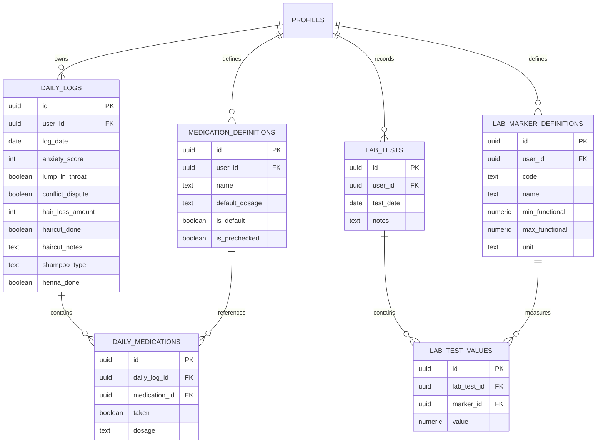

# Plan de Développement : Application Suivi Santé & Cheveux (Hair & Health Tracker)

## 1. Vue d'ensemble du Projet

Application mobile développée en **React Native avec Expo (TypeScript)**, connectée à **Supabase** (PostgreSQL, Auth, RLS) pour la sauvegarde dans le cloud et la synchronisation multi-appareils via **Google OAuth**.

L'application permet d'enregistrer et de corréler :
1. **L'état émotionnel & physique** (anxiété /10, boule dans la gorge, disputes de couple).
2. **La santé capillaire** (chute de cheveux en nombre estimé chiffré, coupes + commentaires, lavages + types de shampoings, pose de henné).
3. **Les compléments & médicaments** (fer bisglycinate + vit C, magnésium, B12, forcapil, iode, sélénium, myo-inositol, + ajout libre).
4. **Les bilans sanguins & normes fonctionnelles** (TSH, NFS, T3, T4, TPO, Ferritine, etc., avec définition personnalisée des intervalles fonctionnels optimaux pour les cheveux).
5. **Tableau de bord statistique** (corrélations stress/chute, régularité des prises, historique).
6. **Calendrier visuel** avec pastilles/icônes filtrables selon les catégories.
7. **Export Excel (.xlsx)** paramétrable par période et par types de données.

### Choix validés :
- **Environnement de test** : Expo Go avec flux Supabase WebBrowser (`expo-web-browser` / `expo-auth-session`).
- **Saisie chute de cheveux** : Saisie numérique directe (ex: 40, 80, 150 cheveux).
- **Thème visuel** : Moderne, neutre et minimaliste (ardoise `#1E293B`, bleu nuit `#0F172A`, touches subtiles de contraste).

---

## 2. Architecture Technique & Dépendances Clés

```
┌────────────────────────────────────────────────────────┐
│                   React Native (Expo)                  │
│  ┌──────────────────┐  ┌────────────────────────────┐  │
│  │   Expo Router    │  │       UI Components        │  │
│  │ (Tabs & Modals)  │  │(Lucide Icons / NativeWind) │  │
│  └─────────┬────────┘  └─────────────┬──────────────┘  │
│            │                         │                 │
│  ┌─────────▼─────────────────────────▼──────────────┐  │
│  │           TanStack Query (React Query)           │  │
│  │        + Gestion du cache / Offline First        │  │
│  └─────────────────────┬────────────────────────────┘  │
│                        │                               │
│  ┌─────────────────────▼────────────────────────────┐  │
│  │       Supabase Client & AuthSession (Google)     │  │
│  └──────────────────────────────────────────────────┘  │
└────────────────────────┬───────────────────────────────┘
                         │
        ┌────────────────▼────────────────┐
        │        Supabase Cloud           │
        │  - PostgreSQL + Row Level Sec   │
        │  - Google OAuth Provider        │
        └─────────────────────────────────┘
```

### Dépendances prévues :
- **Framework** : `expo` (SDK 51+), `expo-router`, `typescript`
- **Authentification & Données** : `@supabase/supabase-js`, `expo-auth-session`, `expo-crypto`, `expo-web-browser`
- **État & Cache** : `@tanstack/react-query`, `@react-native-async-storage/async-storage`
- **Composants & Graphismes** :
  - `lucide-react-native` (icônes modernes et légères)
  - `react-native-calendars` ou composant calendrier custom fluide
  - `react-native-gifted-charts` (statistiques et évolutions claires)
- **Export Excel** : `xlsx`, `expo-file-system`, `expo-sharing`
- **Style** : `nativewind` (Tailwind CSS) ou Thème personnalisé soigné (pastels, doux, orienté bien-être)

---

## 3. Modèle de Données Supabase (Schéma SQL)

Chaque table est protégée par **Row Level Security (RLS)** pour garantir que chaque utilisatrice n'accède qu'à ses propres données (`auth.uid() = user_id`).



---

## 4. Découpage Étape par Étape

### Phase 1 : Initialisation & Socle Technique
1. **Création du projet Expo** avec template TypeScript et structure Expo Router.
2. Configuration des variables d'environnement (`.env` avec Supabase URL & Anon Key).
3. Configuration du système de navigation à onglets (Bottom Tabs) :
   - 📊 **Tableau de bord** (Stats & résumés)
   - 📅 **Calendrier** (Vue chronologique avec pastilles et filtres)
   - ➕ **Saisie du jour** (Bouton central rapide pour enregistrer la journée)
   - 💉 **Normes & Bilans** (Gestion des seuils fonctionnels et saisie des prises de sang)
   - ⚙️ **Paramètres & Export** (Export Excel, gestion compte Google)

### Phase 2 : Authentification Supabase & Google OAuth
1. Configuration du client Supabase avec persistance de session (`AsyncStorage`).
2. Mise en place de la connexion Google via `expo-auth-session` / `expo-web-browser`.
3. Écran de bienvenue / connexion et redirection sécurisée avec statut de synchronisation cloud.

### Phase 3 : Module de Saisie Quotidienne (Journal du Jour)
1. Sélecteur de date (par défaut aujourd'hui, possibilité de renseigner un jour passé).
2. **Bloc Santé & Stress** :
   - Curseur / Slider d'anxiété (0 à 10) avec code couleur (vert -> orange -> rouge).
   - Switch / Bouton bascule : "Boule dans la gorge".
   - Switch / Bouton bascule : "Grosse dispute".
3. **Bloc Traitements & Compléments** :
   - Liste pré-remplie et pré-cochée (Fer bisglycinate + Vit C, Magnésium, B12).
   - Sélecteur de dosage (Forcapil 1 ou 2 gélules, Iode, Sélénium, Myo-inositol).
   - Bouton "+ Ajouter un complément personnalisé" (sauvegardé pour les futures saisies).
4. **Bloc Soins Capillaires** :
   - Évaluation de la perte de cheveux (estimation numérique ou échelle : Légère, Modérée, Importante, Massive).
   - Lavage : Sélecteur de shampoing (*Bébé*, *Sans sulfate*, *Avec sulfate*, *Traitant*).
   - Soin au Henné (Case à cocher).
   - Coupe de cheveux (Case à cocher + champ commentaire libre).
5. Enregistrement automatique ou bouton de validation avec feedback visuel.

### Phase 4 : Calendrier Interactif avec Filtres & Icônes
1. Vue calendrier hebdomadaire et mensuelle.
2. Système de pastilles / badges icônes dynamiques sous chaque date :
   - 💇‍♀️ *Ciseaux* pour coupe de cheveux.
   - 🧴 *Flacon* pour lavage / shampoing.
   - 🌿 *Feuille* pour pose de henné.
   - 💊 *Pilule* pour médicaments pris.
   - ⚡ *Éclair / Nuage* pour anxiété élevée ou dispute.
   - 🩸 *Goutte de sang* pour prise de sang effectuée.
3. Barre supérieure de filtres :
   - Boutons à bascule rapides pour afficher/masquer chaque catégorie d'icônes à volonté.
4. Clic sur une date : ouverture d'une fiche résumé détaillée du jour avec possibilité d'éditer.

### Phase 5 : Module Analyses Sanguines & Normes Fonctionnelles (Icône Seringue 💉)
1. **Gestionnaire des normes fonctionnelles capillaires** :
   - Base pré-enregistrée recommandée (Ferritine, TSH, T3 libre, T4 libre, Anti-TPO, Vitamine D, Zinc...).
   - Formulaire d'édition / ajout : Molécule, Seuil Min, Seuil Max, Unité (µg/L, mUI/L, pg/mL, etc.).
2. **Saisie des bilans sanguins** :
   - Enregistrement d'une prise de sang datée.
   - Remplissage des résultats mesurés.
   - Comparaison visuelle instantanée par rapport à la norme fonctionnelle :
     - 🟢 Dans la norme
     - 🟡 En dessous (ex: ferritine < 70 µg/L)
     - 🔴 Au dessus

### Phase 6 : Tableau de Bord & Statistiques
1. Graphique d'évolution de la perte de cheveux sur 30, 60 ou 90 jours.
2. Courbe croisée : **Niveau d'anxiété & Disputes vs Intensité de chute de cheveux**.
3. Taux d'observance des compléments (pourcentage de jours où le fer/magnésium a été pris).
4. Historique d'évolution des marqueurs sanguins (ex: courbe de remontée de la ferritine au fil des mois).

### Phase 7 : Module d'Exportation Excel (.xlsx)
1. Écran dédié avec sélecteur de période (Dernier mois, 3 derniers mois, 1 an, Période personnalisée).
2. Sélecteur de colonnes / données à inclure (Cases à cocher) :
   - Suivi anxiété & symptômes
   - Compléments & dosages pris
   - Soins capillaires & lavages
   - Résultats des analyses sanguines
3. Génération du fichier Excel via la librairie `xlsx`.
4. Partage direct via la feuille de partage native du téléphone (`expo-sharing` : envoi par mail, enregistrement dans Fichiers, WhatsApp, Drive, etc.).

### Phase 8 : Suivi Menstruel & Prédiction des Prochaines Règles (🩸 Goutte)

> Statut : **en attente de validation** (choix A à D et questions ci-dessous).

**Objectif** : pendant chaque jour de règles, noter le **flux sur 10**, une **petite note** et la **douleur (présente / absente)**, puis prédire la date des prochaines règles.

#### Choix architecturaux à valider
- **A — Modèle de données**
  - **A1 (recommandé)** : 3 colonnes dans `daily_logs` : `menstrual_flow int check (1..10)` (null = pas de règles), `menstrual_pain boolean`, `menstrual_note text`. Enregistrement atomique avec le reste de la journée ; synchro, cache, calendrier et export réutilisés tels quels.
  - **A2** : table dédiée `menstrual_days` (`user_id, date, flow, pain, note`, RLS). Domaine isolé et extensible, mais nouvelle synchro/cache et 2 requêtes par journée (risque d'état partiel).
- **B — Saisie**
  - **B1 (recommandé)** : carte « Cycle menstruel » dans le Journal du jour, enregistrée par le bouton existant « Enregistrer la journée ».
  - **B2** : écran dédié « Cycle » accessible depuis l'accueil (pas de 6ᵉ onglet).
- **C — Données insuffisantes** : **C1 (recommandé)** cycle par défaut de 28 j avec mention « Estimation » / **C2** aucune prédiction avant 2 cycles.
- **D — Activation** : **D1 (recommandé)** interrupteur « Suivi menstruel » dans Paramètres / **D2** toujours visible.

#### Règles de calcul (`src/lib/cycle.ts`, fonctions pures)
1. Jour de règles = journée avec un flux renseigné (1–10).
2. Des jours de règles séparés par **≤ 2 jours** sans flux forment une même période (tolère un oubli de saisie).
3. Longueur de cycle = écart entre deux débuts de période ; valeurs < 15 j ou > 60 j ignorées.
4. Durée prédite = moyenne des **6 derniers cycles** valides (sinon 28 j, cf. choix C).
5. Prochain début = début de la dernière période + durée prédite ; fenêtre ± écart-type (1 à 5 j) ; si la date est dépassée sans saisie → « En retard de X jours ».
6. Durée des règles prédite = moyenne des dernières périodes (défaut 5 j), pour griser les jours prévus.

#### Étapes (avec A1 + B1 + C1 + D1)
1. **Schéma** : colonnes ajoutées dans `supabase_setup.sql` + script de migration `alter table` à exécuter manuellement dans Supabase.
2. **Types** : `DailyLog` += `menstrualFlow`, `menstrualPain`, `menstrualNote` (optionnels pour le cache existant) ; types `Period` et `CyclePrediction`.
3. **Persistance** (`storageService.ts`) : `saveDailyLog` et `syncFromCloud` gèrent les 3 colonnes, conformément à `docs/STORAGE.md` (cloud d'abord, aucune file locale).
4. **Logique de cycle** : `src/lib/cycle.ts` (`getPeriods`, `predictNextPeriod`) basé sur `src/lib/dates.ts`.
5. **Journal du jour** (`DailyEntryForm.tsx`) : interrupteur « Règles aujourd'hui » (pré-activé si la veille avait du flux) → échelle de flux 1–10 (même composant que l'anxiété) avec libellé, douleur Absente / Présente (`Segmented`), note 140 caractères max avec compteur.
   - Erreurs affichées sous les champs : flux manquant si règles activées, note trop longue ; bouton bloqué tant que c'est invalide.
   - Loader + blocage du bouton pendant l'envoi ; erreur réseau → toast 3 s, état précédent conservé.
6. **Calendrier** : catégorie de filtre « Cycle » (couleur dédiée dans `theme.ts`), pastille les jours de règles, jours prédits en teinte légère, détail du jour (flux, douleur, note).
7. **Accueil** : carte « Prochaines règles » (« dans X jours · vers le JJ/MM », « en cours — jour N » ou « en retard de X jours », mention « Estimation » si besoin).
8. **Export Excel** : colonnes « Règles (flux /10) », « Douleur règles », « Note règles ».
9. **Paramètres** : interrupteur d'activation (préférence locale).
10. **Vérifications** : `npx expo lint`, `npx tsc --noEmit`, contrôle visuel des écrans, commit.

#### Tests manuels (connexion internet requise)
Pré-requis : migration SQL exécutée dans Supabase.
- **T1 — Saisie d'un jour de règles**
  1. Ouvrir le Journal du jour.
  2. Activer « Règles aujourd'hui » : flux 6, douleur Présente, note « crampes le matin ».
  3. Enregistrer.
  - *Attendu* : loader, bouton bloqué pendant l'envoi ; valeurs présentes après redémarrage.
  - *Erreur à provoquer* : mode avion avant d'enregistrer → toast d'erreur 3 s, rien n'est enregistré.
- **T2 — Validation**
  1. Activer les règles sans choisir de flux.
  2. Saisir une note de plus de 140 caractères.
  - *Attendu* : messages sous les champs, bouton désactivé, aucune requête envoyée.
- **T3 — Prédiction**
  1. Saisir 3 périodes espacées d'environ un mois.
  2. Ouvrir l'accueil.
  - *Attendu* : date prédite ≈ dernier début + cycle moyen, sans « Estimation » ; avec une seule période : « Estimation » sur 28 j.
  - *Erreur à provoquer* : dépasser la date prédite sans saisie → « En retard de X jours ».
- **T4 — Synchronisation**
  1. Saisir un jour de règles sur un appareil.
  2. Se reconnecter sur un autre appareil.
  - *Attendu* : mêmes données et même prédiction.
  - *Erreur à provoquer* : couper le réseau pendant la connexion → toast d'erreur ; le cache reste lisible, les écritures sont refusées.
- **T5 — Retrait d'un jour de règles**
  1. Désactiver l'interrupteur sur un jour enregistré.
  2. Enregistrer.
  - *Attendu* : données effacées, pastille retirée, prédiction recalculée.
  - *Erreur à provoquer* : réseau coupé → toast d'erreur, le jour reste marqué.
- **T6 — Export**
  1. Exporter une période contenant des règles.
  - *Attendu* : les 3 colonnes remplies aux bonnes dates.

#### Questions ouvertes
1. Choix A1 ou A2 ? 2. Choix B1 ou B2 ? 3. Choix C1 ou C2 ? 4. Choix D1 ou D2 ?
5. Échelle **1–10** (null = pas de règles) ou **0–10** (0 = spotting) ?
6. Notification locale quelques jours avant les règles prévues ? (hors périmètre, nécessiterait `expo-notifications`)

---

## 5. Prochaines Étapes Immédiates

1. Valider vos préférences d'interface et d'environnement de test (voir questions ci-dessous).
2. Initialiser le squelette de l'application Expo dans l'espace de travail.
3. Fournir le script SQL prêt à exécuter dans votre console Supabase pour créer la base et les tables instantanément.
